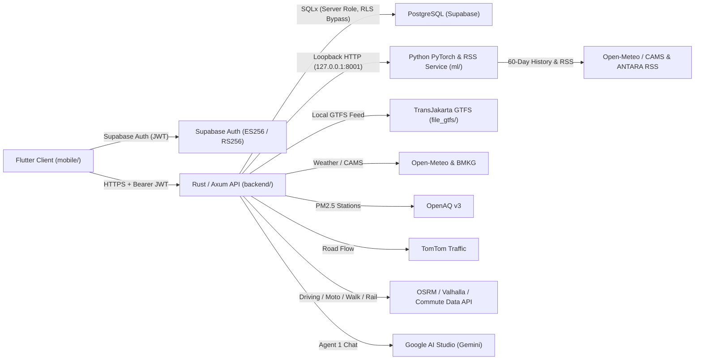

# SUPRA Documentation

**SUPRA** is a commute and environmental intelligence platform built for **Greater Jakarta (Jabodetabek)**. Instead of viewing weather, air pollution, and traffic in isolation, SUPRA combines real-time atmospheric conditions, multimodal route planning, 12-hour PyTorch forecasts, proactive disruption alerts, and a grounded Gemini conversational assistant inside one application.

---

## System Overview

---

## Repository Map

| Directory / File | Responsibility | Key Entry Doc |
| --- | --- | --- |
| [`mobile/`](../mobile/README.md) | Flutter client (Android, iOS, Web, Desktop) with 5-tab `SupraShell`, geographic map, offline/stale-aware caching | [Mobile README](../mobile/README.md) |
| [`backend/`](../backend/README.md) | Rust / Axum REST API, JWKS auth verification, PostgreSQL ownership enforcement, provider orchestration, alert worker | [Backend README](../backend/README.md) |
| [`ml/`](../ml/README.md) | CPU PyTorch 12-hour weather/AQI forecaster (`ForecastNet`) + ANTARA commuter RSS scraper (`serve.py`) | [ML README](../ml/README.md) |
| [`file_gtfs/`](../file_gtfs) | Static TransJakarta GTFS schedule & shape files used by the native Rust transit planner | [Public Transport Spec](../backend/docs/public-transport.md) |
| [`testing/`](../testing/README.md) | Three-stage test runner (`run_checks.py`), `suites.json` test partition, smoke scripts, and evidence logs | [Testing README](../testing/README.md) |
| [`Dockerfile`](../Dockerfile), [`render.yaml`](../render.yaml) | Multi-stage Docker image & Render Blueprint combining `supra_backend`, `ml/serve.py`, and `file_gtfs/` | [Setup & Deployment](setup-and-deployment.md) |

---

## Documentation Index

### Project Documentation (`docs/`)
- **[Architecture & Subsystems](architecture.md)** — Detailed design of the Flutter client, Rust/Axum server modules, Python ML/RSS service, and data freshness guarantees.
- **[API & Database Reference](api-and-database.md)** — Complete REST endpoint catalog from `backend/src/routes.rs` and PostgreSQL schema across all SQLx migrations.
- **[Setup, Testing & Render Deployment](setup-and-deployment.md)** — Local development configuration, 3-stage automated verification, and Render production deployment guide.
- **[Git Workflow Conventions](git-workflow-conventions.md)** — Branching, commit message scopes, issue/PR templates, and regular merge policy.

### Backend Feature Contracts (`backend/docs/`)
- **[Current Conditions & Route Samples](../backend/docs/current-conditions.md)** — Freshness rules for Open-Meteo, BMKG (`adm4`), OpenAQ, CAMS (`45 km` fallback), TomTom, and discrete route sampling.
- **[Public Transport Routing](../backend/docs/public-transport.md)** — Transjakarta GTFS planner, Shiori Labs Commute Data API integration, headway/schematic geometry labeling, and attribution.
- **[Commute Features & Recovery](../backend/docs/commute-features.md)** — Saved places, daily routines, exposure-scored route comparisons, proactive alerts worker, and Supabase password recovery.
- **[Grounded Gemini Assistant & Alert Preferences](../backend/docs/assistant-and-alerts.md)** — Server-verified evidence injection for `/api/agent/chat`, explicit engine attribution, and `news_min_severity` filtering.
- **[Prototype Migration Notes](../backend/docs/prototype-migration.md)** — Legacy schema adoption and explicit UUID migration policy.

### Testing Artifacts (`docs/testing/` & `testing/`)
- **[Testing Overview & Stages](testing/00-integration.md)** — Index to `01-test-plan.md` through `08-test-summary-report.md` and current [test execution results](../testing/RESULTS.md).

---

## Core Design Principles

1. **Zero Fabricated Data:** Provider outages, stale readings (`> 3h` for OpenAQ/CAMS, `> 2h` for Open-Meteo), missing rainfall fields, and unimplemented traffic forecasts are surfaced explicitly as unavailable or stale—never backfilled with synthetic guesses.
2. **Server-Enforced Ownership & Secrets:** Supabase issues ES256/RS256 JWTs verified via JWKS by Axum; all PostgreSQL tables enable Row-Level Security with direct `anon`/`authenticated` access revoked, and all provider/AI keys (`OPENAQ_API_KEY`, `TOMTOM_API_KEY`, `GEMINI_API_KEY`) stay strictly server-side in `backend/.env`.
3. **Graceful Provenance:** Responses clearly distinguish station observations (`OpenAQ`), nearest-road speeds (`TomTom`), regional atmospheric/ML estimates (`Open-Meteo CAMS`, `PyTorch ForecastNet`), schematic transit links, and deterministic fallbacks (`server_data_summary`).
